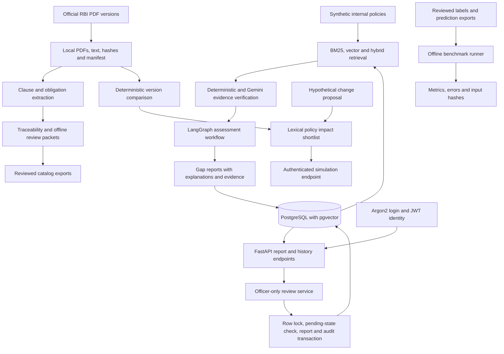

# Architecture

This diagram shows repository components and intended data movement, not proof
that all source drafts have been reviewed or ingested into PostgreSQL. Expansion
previews and synthetic policy drafts remain file-based pending artifacts.
Offline catalog review metadata is separate from authenticated report review.

The API exposes authentication, persisted reports, review history, and change
simulation. Ingestion and assessment are local pipeline operations; they are
not exposed as dashboard ingestion endpoints. Simulation accepts client-supplied
inputs and labels its output hypothetical; source provenance is not database
authenticated. Impact matches are lexical candidates for review.

Only compliance officers can approve or reject pending reports. Reviewer IDs
come from authenticated accounts. Report status and audit history commit in one
transaction, with a row lock preventing competing terminal decisions. Viewers
and admins can read reports but cannot submit decisions.

Operational controls include request IDs, structured request logging, generic
unhandled-error responses, process liveness, database readiness, bounded Gemini
retries, and a read-only audit checker. Benchmark outputs identify their inputs
by hash; they do not certify legal compliance or validate reviewer identity.
